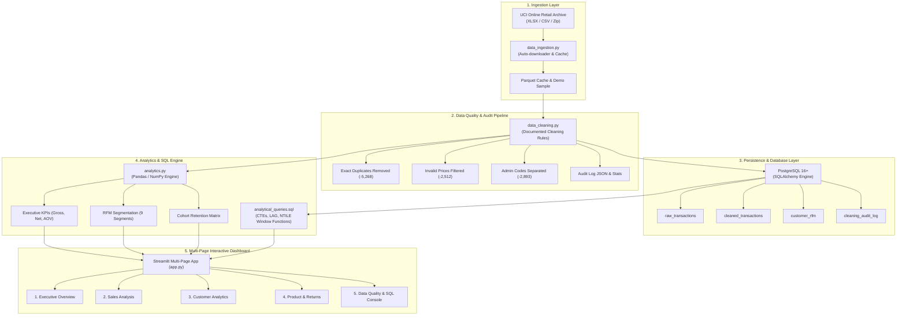

# 🛍️ Retail Pulse: Production-Grade E-Commerce Analytics Platform

[](https://www.python.org/)
[](https://www.postgresql.org/)
[](https://streamlit.io/)
[](https://plotly.com/)
[](https://docs.pytest.org/)

An end-to-end, portfolio-quality commercial analytics platform and interactive dashboard engineered to analyze large-scale e-commerce transaction data. Built with **Python, Pandas, NumPy, PostgreSQL, SQLAlchemy, Streamlit, and Plotly**, this project transforms raw transactional logs into transparent, auditable business intelligence.

---

## 🎯 Project Overview & Business Problem

Retail businesses generate high volumes of transactional log data, yet leadership teams frequently suffer from:
1. **Distorted Revenue Reporting**: Failing to isolate cancelled invoices and returned merchandise leads to artificially inflated revenue and distorted inventory planning.
2. **Missing Customer Identity**: Discarding guest checkouts (~25% of transactions) deflates sales figures, while naively including them corrupts retention and lifetime value models.
3. **One-Size-Fits-All Marketing**: Without customer behavioral segmentation, retention campaigns are untargeted and ineffective.

This platform solves these challenges on the real-world **UCI Online Retail Dataset** (~541,909 transactions spanning Dec 2010 to Dec 2011). It implements a rigorous data cleaning pipeline with an immutable audit trail, computes gross vs. net revenue reconciliation, models customer behavioral segments via **RFM (Recency, Frequency, Monetary)** scoring, computes **Monthly Cohort Retention**, and provides an interactive multi-page dashboard.

---

## 🏗️ System Architecture



---

## 📐 Metric Definitions & Financial Accounting Rules

To ensure strict financial integrity, all analytical terms follow formal e-commerce accounting standards:

| Metric | Formula / Rule | Business Justification |
| :--- | :--- | :--- |
| **Gross Sales** | $\sum (\text{Quantity} \times \text{UnitPrice})$ where $\text{Quantity} > 0 \land \text{UnitPrice} > 0$ | Total merchandise sales before deducting refunds or cancellations. |
| **Returns / Refunds** | $\sum \|\text{Quantity} \times \text{UnitPrice}\|$ where $\text{InvoiceNo}$ starts with `'C'` or $\text{Quantity} < 0$ | Quantifies refunds, returned items, and cancelled orders. |
| **Net Realized Revenue** | $\text{Gross Sales} - \text{Returns}$ | True realized top-line revenue after returns. Discrepancy = $0.00$. |
| **Purchase Orders** | $\text{Count Distinct}(\text{InvoiceNo})$ where $\text{Quantity} > 0 \land \neg \text{Cancelled}$ | Prevents double-counting line items and isolates valid sales orders. |
| **Cancellation Orders** | $\text{Count Distinct}(\text{InvoiceNo})$ where $\text{InvoiceNo}$ starts with `'C'` | Measures distinct return/cancellation events. |
| **Average Order Value (AOV)** | $\frac{\text{Gross Revenue}}{\text{Purchase Orders}}$ (Gross) and $\frac{\text{Net Revenue}}{\text{Purchase Orders}}$ (Net) | Measures basket value per purchase event. |
| **Repeat Purchase Rate** | $\frac{\text{Customers with } \ge 2 \text{ Orders}}{\text{Total Identified Customers}}$ | Measures brand retention among identified buyers. |

---

## 🧹 Data Cleaning Decisions & Audit Trail

The cleaning pipeline processes **541,909 raw records** down to **531,236 valid commercial records** (**98.03% retention rate**):

```
┌────────────────────────────────────────────────────────────────────────────────────────┐
│ STAGE                 │ BEFORE  │ AFTER   │ FILTERED │ % IMPACT │ ACCOUNTING RATIONALE │
├───────────────────────┼─────────┼─────────┼──────────┼──────────┼──────────────────────┤
│ 0_INITIAL             │ 541,909 │ 541,909 │        0 │   0.000% │ Ingested raw records │
│ 1_TYPE_NORMALIZATION  │ 541,909 │ 541,909 │        0 │   0.000% │ Timestamps & trim    │
│ 2_EXACT_DUPLICATES    │ 541,909 │ 536,641 │    5,268 │   0.972% │ Redundant logging    │
│ 3_INVALID_PRICE       │ 536,641 │ 534,129 │    2,512 │   0.468% │ Write-offs & zeroes  │
│ 4_ZERO_QUANTITY       │ 534,129 │ 534,129 │        0 │   0.000% │ Zero qty checks      │
│ 5_ADMIN_STOCK_CODES   │ 534,129 │ 531,236 │    2,893 │   0.542% │ Postage / fees / 'D' │
│ 6_GUEST_CHECKOUTS     │ 531,236 │ 531,236 │        0 │   0.000% │ Preserved for sales  │
└────────────────────────────────────────────────────────────────────────────────────────┘
```

### Guest Checkout Handling (`CustomerID` is NULL)
- **Problem**: 131,580 rows (~24.8% of cleaned rows) lack an account ID, representing £1,506,527.04 (15.42% of net revenue).
- **Executive & Sales Analysis**: Preserved with `is_guest = True` to prevent under-reporting revenue and order counts.
- **Customer Analytics (RFM & Cohorts)**: Isolated to identified customers because multi-session behavioral tracking requires identifiable accounts.

---

## 🚀 Quickstart & Setup Guide

### Prerequisites
- Python 3.11, 3.12, or 3.13
- (Optional for full DB features) PostgreSQL 15+

### Option A: Automated Fast Setup with `uv` (Recommended)

```bash
# 1. Clone repository
git clone <repository_url>
cd "Data analyst"

# 2. Create virtual environment and install dependencies
uv venv --python 3.12
source .venv/bin/activate  # On Windows: .venv\Scripts\activate
uv pip install -r requirements.txt

# 3. Copy environment configuration
cp .env.example .env

# 4. Launch Streamlit Dashboard
streamlit run app.py
```

### Option B: Standard Python `pip` Setup

```bash
# 1. Create and activate venv
python3 -m venv .venv
source .venv/bin/activate  # On Windows: .venv\Scripts\activate

# 2. Install dependencies
pip install -r requirements.txt

# 3. Run data pipeline and populate demo sample
python -c "from src.data_ingestion import load_raw_data; load_raw_data()"

# 4. Launch Streamlit
streamlit run app.py
```

---

## 🗄️ PostgreSQL Setup & Migration

If you have PostgreSQL installed locally:

```bash
# 1. Create database in psql
psql -U postgres -c "CREATE DATABASE ecommerce_analytics;"

# 2. Update .env with your credentials
# DB_HOST=localhost
# DB_PORT=5432
# DB_NAME=ecommerce_analytics
# DB_USER=postgres
# DB_PASSWORD=your_password

# 3. Run automated ETL loader (creates tables, loads raw, clean, RFM data)
python -c "
import pandas as pd
from src.config import RAW_PARQUET_PATH, CLEANED_PARQUET_PATH
from src.analytics import calculate_rfm
from src.data_cleaning import DataCleaner
from src.db_loader import populate_database

raw = pd.read_parquet(RAW_PARQUET_PATH)
clean = pd.read_parquet(CLEANED_PARQUET_PATH)
cleaner = DataCleaner(raw)
_, _ = cleaner.run_pipeline()
audit_df = cleaner.get_audit_df()
rfm_df, _ = calculate_rfm(clean)

populate_database(raw, clean, audit_df, rfm_df)
"
```

> **Zero-Config Local Demo Mode**: If PostgreSQL is not configured, the platform automatically runs in local demo mode using pre-cached high-performance Parquet files.

---

## 📊 Dashboard Tour & Multi-Page Highlights

### 1. 📊 Executive Overview (`pages/1_📊_Executive_Overview.py`)
- Real-time KPI summary: Gross Sales, Net Revenue, Returns Value, Purchase Orders, Unique Customers, Gross AOV, Net AOV.
- Trajectory chart with toggle between Monthly, Weekly, and Daily aggregation.
- Top 10 revenue-generating merchandise SKUs.
- UK vs. International revenue contribution (UK: **84.5%**, International: **15.5%**).

### 2. 📈 Sales Analysis (`pages/2_📈_Sales_Analysis.py`)
- Daily transaction trajectory overlaid with a 7-day rolling moving average.
- Weekday vs. Hour-of-day transaction density heatmap (identifying lunch hour peak: 11:00 AM – 2:00 PM).
- Top 10 international markets ranking and AOV vs. volume scatter plot.

### 3. 👥 Customer Analytics (`pages/3_👥_Customer_Analytics.py`)
- **RFM Segmentation Engine**: Calculates Recency (days), Frequency (orders), and Monetary (spend) scored into 1–5 quintiles.
- Strategic personas: *Champions*, *Loyal Customers*, *Potential Loyalists*, *At Risk*, *Can't Lose Them*, *Lost*.
- Interactive segment treemap, 2D/3D behavioral scatter plot, and strategic business action matrix.
- **Monthly Cohort Retention Heatmap**: Tracks customer retention over 12 months.

### 4. 📦 Product & Returns Analysis (`pages/4_📦_Product_&_Returns.py`)
- Catalog-wide return rate analysis (revenue return rate: **4.64%**, unit return rate: **2.32%**).
- Stacked bar chart comparing Gross Sales vs. Refunds for high-volume products.
- Unit price and quantity distributions highlighting retail vs. bulk wholesale purchases.

### 5. 🔍 Data Quality & Live SQL Terminal (`pages/5_🔍_Data_Quality.py`)
- Data cleaning audit funnel chart detailing record attrition across each transformation.
- Detailed breakdown of guest checkout impact on financial reporting.
- **Interactive PostgreSQL SQL Console**: Execute advanced CTE queries with `LAG()`, `NTILE()`, and conditional aggregations directly from the browser.

---

## 💻 Advanced SQL Showcase

The platform demonstrates advanced analytical SQL patterns in [`sql/analytical_queries.sql`](file:///home/night/Data%20analyst/sql/analytical_queries.sql):

### 1. Month-over-Month Growth with `LAG()` Window Function
```sql
WITH monthly_metrics AS (
    SELECT
        year_month,
        COUNT(DISTINCT CASE WHEN NOT is_cancelled THEN invoice_no END) AS purchase_orders,
        SUM(CASE WHEN NOT is_cancelled THEN line_total ELSE 0 END) AS gross_revenue,
        SUM(line_total) AS net_revenue
    FROM cleaned_transactions
    GROUP BY year_month
),
mom_growth AS (
    SELECT
        year_month,
        purchase_orders,
        net_revenue,
        LAG(net_revenue, 1) OVER (ORDER BY year_month) AS prev_net_revenue
    FROM monthly_metrics
)
SELECT
    year_month,
    purchase_orders,
    ROUND(net_revenue, 2) AS net_revenue,
    ROUND(((net_revenue - prev_net_revenue) / prev_net_revenue) * 100.0, 2) AS mom_growth_pct
FROM mom_growth;
```

### 2. Direct SQL RFM Scoring with `NTILE(5)` Window Functions
```sql
WITH customer_summary AS (
    SELECT
        customer_id,
        DATE_PART('day', (SELECT MAX(invoice_date) + INTERVAL '1 day' FROM cleaned_transactions) - MAX(invoice_date))::INT AS recency_days,
        COUNT(DISTINCT CASE WHEN NOT is_cancelled THEN invoice_no END) AS frequency_orders,
        SUM(line_total) AS monetary_spend
    FROM cleaned_transactions
    WHERE NOT is_guest AND customer_id IS NOT NULL
    GROUP BY customer_id
    HAVING SUM(line_total) > 0
)
SELECT
    customer_id,
    recency_days,
    frequency_orders,
    monetary_spend,
    NTILE(5) OVER (ORDER BY recency_days DESC) AS r_score,
    NTILE(5) OVER (ORDER BY frequency_orders ASC) AS f_score,
    NTILE(5) OVER (ORDER BY monetary_spend ASC) AS m_score
FROM customer_summary;
```

---

## 🧪 Automated Testing Suite

The repository includes a comprehensive automated test suite powered by `pytest` verifying data cleaning, metric formulas, and RFM calculations.

```bash
# Run test suite
pytest
```

**Test Coverage Highlights**:
- `tests/test_cleaning.py`: Validates exact duplicate removal, invalid price elimination, administrative stock code filtering, cancellation tagging, and guest checkout preservation.
- `tests/test_metrics.py`: Confirms Gross - Returns = Net revenue reconciliation, purchase order distinct counts, AOV formulas, and cohort retention boundary conditions.
- `tests/test_rfm.py`: Verifies RFM quintile score bounds (1 to 5), customer segment categorization, and exclusion of guest checkouts.

---

## 📂 Project Structure

```
Data analyst/
├── .env.example              # Environment variables template
├── .gitignore                # Git ignore rules
├── README.md                 # Complete system documentation
├── PORTFOLIO_SUMMARY.md      # Analytical case study & findings
├── requirements.txt          # Python dependencies
├── pytest.ini                # Pytest configuration
├── data/
│   ├── raw/                  # Downloaded raw dataset & parquet cache
│   ├── processed/            # Cleaned parquet dataset & audit log
│   └── sample/               # Representative demo sample CSV
├── sql/
│   ├── schema.sql            # PostgreSQL table DDL & analytical indexes
│   ├── analytical_queries.sql# Portfolio SQL queries (CTEs, Window Functions)
│   └── verify_integrity.sql  # Data reconciliation queries
├── src/
│   ├── __init__.py
│   ├── config.py             # Global configurations & paths
│   ├── data_ingestion.py     # Download, caching, and sampling
│   ├── data_cleaning.py      # Cleansing pipeline & audit trail
│   ├── db.py                 # SQLAlchemy connection pool & health check
│   ├── db_loader.py          # Batch ETL database loader
│   ├── sql_analytics.py      # SQLAlchemy runner for analytical queries
│   ├── analytics.py          # KPIs, RFM engine, cohorts, heatmaps
│   └── visualizations.py     # Plotly interactive figure builders
├── app.py                    # Main Streamlit dashboard entrypoint
├── pages/                    # Multi-page dashboard modules
│   ├── 1_📊_Executive_Overview.py
│   ├── 2_📈_Sales_Analysis.py
│   ├── 3_👥_Customer_Analytics.py
│   ├── 4_📦_Product_&_Returns.py
│   └── 5_🔍_Data_Quality.py
└── tests/
    ├── __init__.py
    ├── test_cleaning.py
    ├── test_metrics.py
    └── test_rfm.py
```

---

## ⚠️ Analytical Assumptions & Limitations

1. **Currency**: All monetary values are denominated in British Pounds Sterling (£), consistent with the UK-based retailer dataset.
2. **Timezone**: Timestamps are recorded in local UK time (GMT/BST).
3. **Causation vs. Correlation**: Observed spikes (e.g. November sales surge) correlate with pre-holiday inventory restocking by wholesale clients, but should not be assumed as purely retail Christmas shopping without demographic context.
4. **Guest Checkouts**: 24.8% of transaction records do not have customer account numbers. While included in sales reporting, customer lifetime values and repeat purchase rates reflect the identifiable customer base.

---

## 👤 Author & License

Created as a portfolio-grade Data Analytics project demonstrating data pipeline design, database architecture, advanced SQL, and executive dashboard engineering.
Licensed under the [MIT License](LICENSE).
